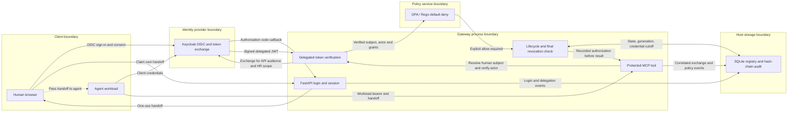

# Agent Identity Gateway architecture

The gateway keeps human identity and workload identity separate. For the HR demo, the human remains the subject of delegated access and the configured agent remains the actor. MCP returns verified identity metadata for one demo resource.

## Delegation and authorization

1. After browser login and consent, the gateway checks the human access token's audience, delegation scope and `may_act` binding. The gateway stores the human token server-side and issues an opaque handoff to the authenticated browser.
2. MCP verifies the workload bearer, matches its client and subject to the handoff's human token, checks lifecycle state and atomically consumes the handoff. The gateway submits the human subject token and agent actor token to the configured confidential client exchange.
3. The output must keep the same human `sub` and verified agent `act`, target exactly the configured API audience, have the `hr_team_read` authorization scope, and expire no later than either input. The gateway also rejects added roles.
4. OPA evaluates the verified claims and local grants for `read_hr_team` on `hr_team/demo-team`. An explicit allow is required. Invalid or unavailable policy responses deny the operation. The final SQLite transaction rechecks lifecycle and expiry and persists the invocation record before returning the result.
5. Local suspension, deprovisioning, and rotation checks gate subsequent requests. A confirmed rotation advances the bearer issuance cutoff. Applying a rotation invalidates existing handoffs even if the provider fails. Provider-side credential revocation requires separate verification.

## Operational boundaries

Keycloak and OPA have separate loopback Compose services. Uvicorn runs on the host. Use one gateway worker, a private persistent SQLite path, HTTPS for non-loopback deployment, and restricted Keycloak and OPA administration. Browser sessions and handoffs are lost on restart. Audit hashes detect inconsistencies relative to the stored head. Independent verification against a privileged rewrite requires a separate trusted checkpoint.

Tests use mocked Keycloak and real OPA coverage. The existing Z3 checks reason about an abstract policy model. Live exchange and recovery client configuration remain open acceptance items. See the [threat model](THREAT_MODEL.md) for evidence and residual risks.

## Browser authentication details

The browser starts at `/auth/login`. FastAPI generates a random state, nonce and PKCE verifier. It stores the verifier and nonce in a five-minute server-side transaction and sets an HttpOnly, SameSite=Lax cookie restricted to the callback path. Keycloak receives the state, nonce and S256 challenge and handles user sign-in.

On callback, FastAPI matches the returned state to the browser cookie and atomically consumes the transaction. It sends the code, original verifier, redirect URI and confidential client credentials to Keycloak's token endpoint. It verifies the ID token's signature, issuer, expiry, client audience and nonce. It checks the access-token hash when present and requires both tokens to identify the same subject. A successful login creates a fresh opaque session cookie and redirects to `/auth/me`. The gateway keeps the access token in memory and discards the ID and refresh tokens after the exchange.

The token verifier reads the `kid` header to select an RSA public signing key from the configured realm's JWKS endpoint. It accepts RS256 and verifies the signature, exact issuer, expiration, API audience and Keycloak access-token type. It extracts identity and realm roles from verified claims. Keys are cached for five minutes, with a refresh attempt on an unknown key subject to a ten-second request cooldown. A provider outage produces 503 when the gateway needs keys and has no usable cached key.

FastAPI revalidates the access token on each protected request. Browser sessions are usable for up to 15 minutes and end earlier when the access token expires. Explicit bearer credentials take precedence over the browser cookie. The role dependencies require exact membership in the named realm role and return 403 when the caller lacks it.

Login transactions and sessions are bounded in-memory stores for a single gateway process. Restarting the gateway clears both, and multiple workers require shared storage. Instant logout, revocation and role changes are outside this phase. Use HTTPS for deployment so cookies carry the Secure flag. HTTP is supported for loopback development. Run without Uvicorn access logging and keep callback query strings out of proxy logs because they contain authorization codes. Authentication responses use no-store and no-referrer headers.

[OpenID Connect Core](https://openid.net/specs/openid-connect-core-1_0.html) · [Keycloak server administration guide](https://www.keycloak.org/docs/latest/server_admin/)
